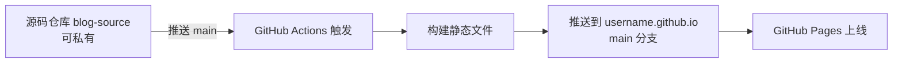

> 本文讲解基于 GitHub 搭建个人博客的完整流程：从新建仓库、启用 Pages 讲起，以"纯手写 HTML"演示静态博客原理，再对比 Jekyll、Hexo、Hugo 三种生成器方案，最后介绍 GitHub Actions 自动部署、自定义域名与 SEO 优化。

---

## 一、整体方案概览

GitHub Pages 是 GitHub 提供的静态站点托管服务，将仓库中的静态文件（HTML/CSS/JS/图片）直接发布为可访问网站，免费、自带 HTTPS、支持自定义域名。

**静态博客的运作原理**：博客 = 一堆静态 HTML 文件 + 一个对外提供 HTTP 访问的服务器。无论使用何种生成器或纯手写 HTML，最终交付给 GitHub Pages 的都是纯静态资源，区别仅在于"如何生成这些 HTML"。

**主流方案对比**：

| 维度 | 纯手写 HTML | Jekyll | Hexo | Hugo |
|------|------------|--------|------|------|
| 开发语言 | 无 | Ruby | Node.js | Go |
| GitHub Pages 原生支持 | 是 | 是（默认构建） | 否，需 Actions | 否，需 Actions |
| 主题生态 | 无 | 丰富 | 中文社区活跃 | 数量多 |
| 构建速度 | 无需构建 | 较慢 | 中等 | 极快 |
| 适合场景 | 演示原理、极简页面 | 偏好原生集成 | 中文开发者 | 大型站点、追求性能 |

---

## 二、新建仓库与启用 GitHub Pages

### 2.1 创建博客仓库

GitHub Pages 站点分两类，仓库名决定访问 URL：

| 站点类型 | 仓库名 | 访问 URL |
|---------|--------|---------|
| 用户站点 | `username.github.io` | `https://username.github.io` |
| 项目站点 | 任意 | `https://username.github.io/repo` |

新建仓库时命名为 `<你的用户名>.github.io`，可见性选 **Public**（私有仓库需 GitHub Pro 才能启用 Pages），勾选 **Add a README file**。

### 2.2 启用 GitHub Pages

进入仓库 **Settings → Pages → Build and deployment**：

- **Source** 选择 `Deploy from a branch`（直接发布静态文件）或 `GitHub Actions`（需构建的方案）
- 选择 `Deploy from a branch` 后，设置 Branch 为 `main`、Folder 为 `/ (root)`

保存后 1~2 分钟，页面顶部显示 `Your site is live at https://username.github.io/` 即上线成功。

### 2.3 克隆与验证

```bash
git clone https://github.com/username/username.github.io.git
cd username.github.io
```

创建 `hello.html` 推送验证：

```bash
git add hello.html
git commit -m "test: 验证 Pages 上线"
git push origin main
```

访问 `https://username.github.io/hello.html` 看到页面即说明博客底层运作机制跑通。

---

## 三、方案一：纯手写 HTML

不使用任何生成器、主题、依赖，仅用纯 HTML/CSS 搭建最小博客，直观理解静态博客如何运作。

### 3.1 目录结构

```
username.github.io/
├── index.html          # 首页（文章列表）
├── about.html          # 关于页
├── posts/
│   └── hello-world.html
├── assets/
│   └── style.css
├── robots.txt
├── sitemap.xml
└── CNAME               # 自定义域名（可选）
```

### 3.2 首页 index.html

```html
<!DOCTYPE html>
<html lang="zh-CN">
<head>
  <meta charset="UTF-8">
  <meta name="viewport" content="width=device-width, initial-scale=1.0">
  <meta name="description" content="我的个人技术博客">
  <title>我的博客</title>
  <link rel="stylesheet" href="/assets/style.css">
</head>
<body>
  <header>
    <h1><a href="/">我的博客</a></h1>
    <nav>
      <a href="/">首页</a>
      <a href="/about.html">关于</a>
      <a href="https://github.com/username">GitHub</a>
    </nav>
  </header>

  <main>
    <article>
      <h2><a href="/posts/hello-world.html">Hello World</a></h2>
      <time>2026-07-27</time>
      <p>这是我的第一篇博客，记录搭建过程。</p>
    </article>
  </main>

  <footer>
    <p>&copy; 2026 你的名字. Powered by GitHub Pages.</p>
  </footer>
</body>
</html>
```

### 3.3 文章页 posts/hello-world.html

```html
<!DOCTYPE html>
<html lang="zh-CN">
<head>
  <meta charset="UTF-8">
  <meta name="viewport" content="width=device-width, initial-scale=1.0">
  <title>Hello World - 我的博客</title>
  <link rel="stylesheet" href="/assets/style.css">
</head>
<body>
  <header>
    <h1><a href="/">我的博客</a></h1>
    <nav>
      <a href="/">首页</a>
      <a href="/about.html">关于</a>
    </nav>
  </header>

  <main>
    <article>
      <h2>Hello World</h2>
      <time>2026-07-27</time>
      <p>GitHub Pages 的本质：把仓库中的静态文件通过 HTTP 服务暴露出去，
      浏览器请求某个 URL，GitHub 返回对应的文件。</p>
    </article>
  </main>

  <footer>
    <p>&copy; 2026 你的名字.</p>
  </footer>
</body>
</html>
```

### 3.4 样式 assets/style.css

```css
body {
  max-width: 720px;
  margin: 0 auto;
  padding: 2rem 1rem;
  font-family: -apple-system, "PingFang SC", "Microsoft YaHei", sans-serif;
  line-height: 1.7;
  color: #24292f;
}
header {
  display: flex;
  justify-content: space-between;
  align-items: center;
  border-bottom: 1px solid #d0d7de;
  padding-bottom: 1rem;
}
nav a { margin-left: 1rem; color: #0969da; text-decoration: none; }
article { margin: 1.5rem 0; padding-bottom: 1.5rem; border-bottom: 1px solid #d0d7de; }
article h2 a { color: #24292f; text-decoration: none; }
article h2 a:hover { color: #0969da; }
time { color: #6e7781; font-size: 0.9rem; }
footer { margin-top: 2rem; text-align: center; color: #6e7781; font-size: 0.85rem; }
```

### 3.5 SEO 辅助文件

**robots.txt**：

```
User-agent: *
Allow: /
Sitemap: https://username.github.io/sitemap.xml
```

**sitemap.xml**（手动维护）：

```xml
<?xml version="1.0" encoding="UTF-8"?>
<urlset xmlns="http://www.sitemaps.org/schemas/sitemap/0.9">
  <url><loc>https://username.github.io/</loc><lastmod>2026-07-27</lastmod></url>
  <url><loc>https://username.github.io/posts/hello-world.html</loc><lastmod>2026-07-27</lastmod></url>
</urlset>
```

### 3.6 发布与原理总结

```bash
git add .
git commit -m "feat: 初始化纯手写 HTML 博客"
git push origin main
```

推送即上线，无需构建。博客本质一览：

| 关注点 | 实现方式 |
|--------|---------|
| 内容 | HTML 文件直接编写 |
| 样式 | 共享 CSS 文件 |
| 路由 | 目录结构对应 URL |
| 发布 | Git 推送即上线 |
| 托管 | GitHub Pages 提供 HTTP 服务 |

**方案局限**：每篇文章都要复制 header/footer、文章列表需手动维护、不支持 Markdown、无标签/分类/搜索/评论。这些正是 Jekyll/Hexo/Hugo 要解决的问题——它们用模板与 Markdown 解决重复与可维护性问题，但产物依然是 HTML 静态文件，运行机制与本节完全一致。

---

## 四、方案二：Jekyll（GitHub Pages 原生支持）

Jekyll 是 GitHub Pages 默认构建引擎，推送 Markdown 后 GitHub 自动渲染为站点，无需配置 CI。

### 4.1 本地环境

```bash
# macOS
brew install ruby chruby ruby-install
# Ubuntu / Debian
sudo apt install ruby-full build-essential zlib1g-dev
# 通用
gem install jekyll bundler
```

Windows 使用 RubyInstaller。

### 4.2 初始化与预览

```bash
jekyll new . --force
bundle exec jekyll serve   # 访问 http://127.0.0.1:4000
```

目录结构：

```
.
├── _config.yml       # 站点配置
├── _posts            # 文章目录
├── _drafts           # 草稿目录
├── about.markdown
└── index.markdown
```

### 4.3 配置 _config.yml

```yaml
title: 你的博客名
description: 博客描述
url: "https://username.github.io"
baseurl: ""                 # 用户站点留空，项目站点填 "/repo"
theme: minima                # GitHub Pages 官方支持的主题
plugins:
  - jekyll-feed
  - jekyll-seo-tag
```

主题列表见 [github/pages-themes](https://github.com/pages-themes)。

### 4.4 发布文章

文章放 `_posts` 目录，文件名遵循 `YYYY-MM-DD-title.md`：

```markdown
---
layout: post
title:  "我的第一篇 Jekyll 博客"
date:   2026-07-27 10:00:00 +0800
categories: 技术
---

正文内容，支持 Markdown。
```

推送后约 1 分钟即可访问 `https://username.github.io`。

---

## 五、方案三：Hexo（中文社区主流）

基于 Node.js 的高效博客框架，主题丰富、配置灵活。

### 5.1 安装与初始化

```bash
npm install -g hexo-cli
hexo init blog
cd blog && npm install
hexo clean && hexo g && hexo s   # 访问 http://localhost:4000
```

常用命令：

| 命令 | 缩写 | 作用 |
|------|------|------|
| `hexo new "标题"` | - | 新建文章 |
| `hexo generate` | `hexo g` | 生成静态文件到 `public/` |
| `hexo server` | `hexo s` | 启动本地预览 |
| `hexo deploy` | `hexo d` | 按 deploy 配置推送 |
| `hexo clean` | - | 清理缓存与 `public/` |

### 5.2 安装主题与配置

```bash
npm install hexo-theme-next
```

`_config.yml` 关键配置：

```yaml
title: 你的博客名
author: 你的名字
language: zh-CN
timezone: Asia/Shanghai
url: https://username.github.io
permalink: :year/:month/:day/:title/
theme: next

deploy:
  type: git
  repo: https://github.com/username/username.github.io.git
  branch: main
```

### 5.3 发布文章

```bash
hexo new "我的第一篇 Hexo 博客"
```

生成文件 `source/_posts/我的第一篇-Hexo-博客.md`：

```markdown
---
title: 我的第一篇 Hexo 博客
date: 2026-07-27 10:00:00
tags: [技术, 博客]
categories: [随笔]
---

正文内容。
```

### 5.4 一键部署（传统方式）

```bash
npm install hexo-deployer-git --save
hexo clean && hexo g && hexo d
```

Hexo 将 `public/` 推送到 `username.github.io` 仓库。注意此方式需本地构建，**推荐使用 GitHub Actions 自动部署**。

---

## 六、方案四：Hugo（追求性能）

Go 编写，构建速度极快，单文件可执行，适合大型站点。

### 6.1 安装与初始化

```bash
# macOS
brew install hugo
# Windows (Scoop)
scoop install hugo-extended

hugo new site blog
cd blog
```

### 6.2 安装主题与配置

```bash
git init
git submodule add https://github.com/adityatelange/hugo-PaperMod themes/PaperMod
```

`config.yml`：

```yaml
baseURL: https://username.github.io/
languageCode: zh-cn
title: 你的博客名
theme: PaperMod
params:
  homeInfoParams:
    Title: "你好"
    Content: 欢迎来到我的博客
```

### 6.3 创建文章与预览

```bash
hugo new posts/my-first-post.md
hugo server -D   # -D 包含草稿，访问 http://localhost:1313
```

文章 Front Matter：

```markdown
---
title: "我的第一篇 Hugo 博客"
date: 2026-07-27T10:00:00+08:00
draft: true
tags: [博客]
---

正文内容。
```

`draft: true` 表示草稿，发布前改为 `false`。

### 6.4 构建

```bash
hugo --minify   # 静态文件输出到 public/
```

将 `public/` 推送到 GitHub Pages 仓库，或使用下节 GitHub Actions 自动部署。

---

## 七、GitHub Actions 自动部署

推荐"双仓库"模式，将源码与构建产物分离：



| 仓库 | 用途 | 可见性 |
|------|------|--------|
| `blog-source` | 博客源码、主题、配置 | 可私有 |
| `username.github.io` | 构建产物 | 公开 |

### 7.1 配置个人访问令牌（PAT）

GitHub Actions 推送构建产物到发布仓库需要认证，使用 Personal Access Token（PAT）：

1. 访问 GitHub → Settings → Developer settings → Personal access tokens → **Tokens (classic)** → Generate new token
2. 勾选 `repo` 权限（Full control of private repositories）
3. 生成后复制 token（仅显示一次）
4. 在 `blog-source` 仓库 Settings → Secrets and variables → Actions → New repository secret
5. 名称填 `GH_TOKEN`，值为复制的 token

### 7.2 Hexo 自动部署 Workflow

在 `blog-source` 仓库创建 `.github/workflows/deploy.yml`：

```yaml
name: Deploy Hexo to GitHub Pages
on:
  push:
    branches: [main]
  workflow_dispatch:

permissions:
  contents: read

jobs:
  build-deploy:
    runs-on: ubuntu-latest
    steps:
      - uses: actions/checkout@v4
        with:
          ref: main
          submodules: true

      - uses: actions/setup-node@v4
        with:
          node-version: '20'
          cache: 'npm'

      - run: npm install

      - name: 构建
        run: |
          npx hexo clean
          npx hexo g

      - name: 部署到 username.github.io
        uses: peaceiris/actions-gh-pages@v3
        with:
          github_token: ${{ secrets.GH_TOKEN }}
          publish_dir: ./public
          publish_branch: main
          repo: username/username.github.io
```

### 7.3 Hugo 自动部署 Workflow

```yaml
name: Deploy Hugo to GitHub Pages
on:
  push:
    branches: [main]
  workflow_dispatch:

permissions:
  contents: read

jobs:
  build-deploy:
    runs-on: ubuntu-latest
    steps:
      - uses: actions/checkout@v4
        with:
          submodules: true

      - uses: peaceiris/actions-hugo@v3
        with:
          hugo-version: 'latest'
          extended: true

      - name: 构建
        run: hugo --minify --baseURL "https://username.github.io/"

      - name: 部署到 username.github.io
        uses: peaceiris/actions-gh-pages@v3
        with:
          github_token: ${{ secrets.GH_TOKEN }}
          publish_dir: ./public
          publish_branch: main
          repo: username/username.github.io
```

说明：`peaceiris/actions-gh-pages` 通过 `github_token` 自动认证并推送到目标仓库的指定分支，无需配置 SSH 密钥。

---

## 八、自定义域名绑定

### 8.1 域名解析

在域名服务商控制台添加记录：

| 记录类型 | 主机记录 | 记录值 | 说明 |
|---------|---------|--------|------|
| A | @ | 185.199.108.153 | GitHub Pages IPv4 |
| A | @ | 185.199.109.153 | GitHub Pages IPv4 |
| A | @ | 185.199.110.153 | GitHub Pages IPv4 |
| A | @ | 185.199.111.153 | GitHub Pages IPv4 |
| CNAME | www | username.github.io | 子域名指向 |

### 8.2 GitHub 配置

在 `username.github.io` 仓库根目录添加 `CNAME` 文件（无扩展名），内容为域名：

```
www.yourdomain.com
```

或在 Settings → Pages → Custom domain 填入保存。

### 8.3 启用 HTTPS

DNS 生效后在 Pages 设置页勾选 **Enforce HTTPS**。

### 8.4 站点配置调整

绑定域名后调整站点 URL，否则站内资源链接指向 `github.io` 导致混合内容告警：

```yaml
# Hexo _config.yml
url: https://www.yourdomain.com
root: /

# Hugo config.yml
baseURL: https://www.yourdomain.com/
```

---

## 九、SEO 与性能优化

### 9.1 SEO 基础

- 在站点配置中完善 `title`、`description`、`keywords`
- 生成 `sitemap.xml` 提交至[百度搜索资源平台](https://ziyuan.baidu.com)
- 添加 `robots.txt` 引导爬虫
- Hexo 插件：`npm install hexo-generator-sitemap hexo-generator-robots-txt --save`
- Hugo 内置 sitemap，访问 `/sitemap.xml` 自动生成
- 纯手写方案手动维护 `sitemap.xml`（见 3.5 节）
- 文章 URL 使用英文短横线分隔，每篇添加 3~5 个精准 `tags`

### 9.2 性能优化

| 优化方向 | 具体措施 |
|---------|---------|
| 图片优化 | WebP 格式，`loading="lazy"`，单图 < 200KB |
| 资源压缩 | Hugo `--minify`，Hexo `hexo-neat` |
| CDN 加速 | Cloudflare 或自定义域名 CDN |
| 评论系统 | 选轻量方案（giscus、utterances） |
| 分析统计 | Google Analytics 4 或 Cloudflare Web Analytics |

### 9.3 评论系统（giscus）

基于 GitHub Discussions，无需数据库：

1. 启用仓库 Discussions 功能
2. 在 [giscus.app](https://giscus.app) 配置并复制 `<script>` 片段
3. 嵌入主题对应位置（Hexo NexT `_config.next.yml`、Hugo 主题 `comments.html`、纯手写 HTML 文章页底部）

---

## 十、常见问题与排错

### 10.1 页面 404

| 现象 | 原因 | 解决方案 |
|------|------|---------|
| `username.github.io` 显示 404 | 仓库名拼写错误 | 严格为 `username.github.io`，区分大小写 |
| 项目站点 404 | `baseurl` 未配置 | Jekyll 项目站点设 `baseurl: "/repo"` |
| 自定义域名 404 | DNS 未生效或 CNAME 未提交 | 等待 DNS 生效，确认 `CNAME` 文件 |
| 部署后页面未更新 | 浏览器或 CDN 缓存 | 强制刷新 `Ctrl+F5`，等待 5~10 分钟 |
| Pages 设置页提示未启用 | Source 未配置 | 按 2.2 节步骤选择 Branch 与 Folder |

### 10.2 GitHub Actions 构建失败

查看日志：仓库 → Actions → 选择失败的工作流 → 查看步骤日志。

| 错误 | 排查方向 |
|------|---------|
| `Permission denied` 或 `403` | PAT 权限不足或已过期，重新生成并更新 `GH_TOKEN` |
| `Resource not accessible` | `repo` 权限未勾选，或 `repo` 字段格式错误 |
| `fatal: not a git repository` | `submodules: true` 配置缺失 |
| `hexo: command not found` | `npm install` 未执行，或 Hexo 未作为本地依赖 |
| `Theme not found` | 主题以 submodule 引入但未执行 `git submodule update` |
| 部署成功但页面未更新 | 发布仓库 Pages Source 未设为 `main` 分支 |

### 10.3 GitHub Pages 构建限制

| 限制项 | 数值 |
|--------|------|
| 单次构建超时 | 10 分钟 |
| 构建频率 | 软限制 10 次/小时 |
| 仓库大小建议 | < 1 GB |
| 站点带宽建议 | < 100 GB/月 |

超出限制可迁移至 Cloudflare Pages、Vercel、Netlify 等同类服务。

---

## 十一、方案选型建议

| 场景 | 推荐方案 | 理由 |
|------|---------|------|
| 演示原理、教学、极简页面 | 纯手写 HTML | 零依赖、零构建，直观展示运作机制 |
| 零配置、最少维护 | Jekyll + GitHub Pages 原生 | 无需 CI，推送即上线 |
| 中文社区、主题丰富 | Hexo + NexT + GitHub Actions | 文档中文友好，主题成熟 |
| 文章数 > 500、追求性能 | Hugo + GitHub Actions | 毫秒级构建，扩展性强 |
| 全栈定制（评论、搜索、统计） | Next.js + Contentlayer + Vercel | React 生态灵活扩展 |

**通用最佳实践**：

1. **理解原理再上工具**：先用纯手写 HTML 跑通最小闭环
2. **源码与产物分离**：双仓库或 `gh-pages` 分支隔离
3. **自动化部署**：统一通过 GitHub Actions 部署，避免本地环境差异
4. **版本控制主题**：Git Submodule 或 `package.json` 锁定版本
5. **保持简洁**：避免堆砌过多插件与脚本，加载速度是核心

---

## 总结

基于 GitHub Pages 搭建个人博客的核心价值在于**免费、稳定、与版本控制深度集成**。

三种主流生成器各有定位：Jekyll 适合追求最小化配置的原生方案，Hexo 在中文社区与主题生态上优势明显，Hugo 凭借 Go 实现的极快构建速度适合大型站点。工程实践的关键不在选型，而在于建立**"源码仓库 + GitHub Actions 自动构建 + 发布仓库"**的标准化部署流程，将写作与发布解耦，使作者只需关注内容创作。结合自定义域名、HTTPS、SEO 配置与性能优化，即可搭建出一个专业、稳定、可长期运营的个人技术博客。

<p align="center">
    <a href="https://github.com/dkbnull/hello-wiki/blob/main/99-Misc/02-GitHub%E6%90%AD%E5%BB%BA%E4%B8%AA%E4%BA%BA%E5%8D%9A%E5%AE%A2.md" target="_blank">
        
    </a>
    <a href="https://gitee.com/dkbnull/hello-wiki/blob/main/99-Misc/02-GitHub%E6%90%AD%E5%BB%BA%E4%B8%AA%E4%BA%BA%E5%8D%9A%E5%AE%A2.md" target="_blank">
        
    </a>
    <a href="https://mp.weixin.qq.com/s/Nr8Nmcw26dkdwCNEGG1SxA" target="_blank">
       
    </a>
    <a href="https://juejin.cn/post/7667424209937924147" target="_blank">
       
    </a>
    <a href="https://zhuanlan.zhihu.com/p/2065592052050551153" target="_blank">
       
    </a>
</p>
